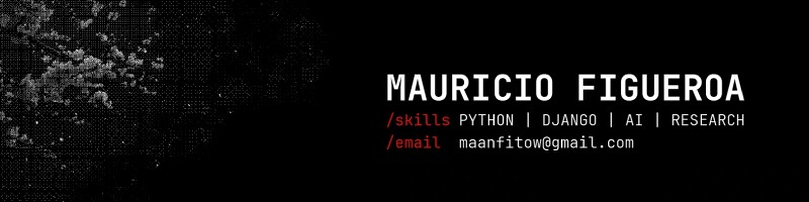

<!-- Profile Banner -->

<strong>Backend Developer &nbsp;·&nbsp; Python &amp; Django &nbsp;·&nbsp; Mechatronics Engineer</strong>

&nbsp;&nbsp;

---

## About Me

I'm a **Software Developer** and **Mechatronics Engineer** from Bolivia, specializing in backend development with **Python** and **Django**. My engineering background shapes an analytical, systems-oriented approach to building backend services, REST APIs, relational databases, and containerized deployment environments.

Interested in backend architecture, database engineering, automation, and applied artificial intelligence. **Currently focused on building reliable, maintainable, and scalable software solutions.**

## Professional Experience

**Software Developer / Consultant**

Developing and maintaining web applications using Django, Python, JavaScript, and PostgreSQL.

* Backend application development and business logic.
* REST API design and integration.
* Relational database design and management.
* Application deployment and Linux server administration.
* Docker-based development and deployment environments.
* Debugging, maintenance, and optimization of existing systems.

## Technical Stack

| Area | Technologies |
| :--- | :--- |
| **Languages** |   |
| **Backend** |   |
| **Databases** |   |
| **DevOps & Infrastructure** |       |
| **Frontend** |    |

## Education

**B.Sc. in Mechatronics Engineering** — Universidad Católica Boliviana (Bolivia)

* Graduated with High Honors.
* Academic GPA: 94.05/100.
* Best Mechatronics Engineering Student (2021): 97.8/100.

**International Academic Experience** — Universidad Adolfo Ibáñez (Chile)

* UAI Imagine Global Classroom LATAM, Fall 2021.

## Languages

**Spanish** (Native) &nbsp;·&nbsp; **English** (Professional working proficiency)

---

<i>Engineering mindset. Software-driven solutions. Continuous improvement.</i>

